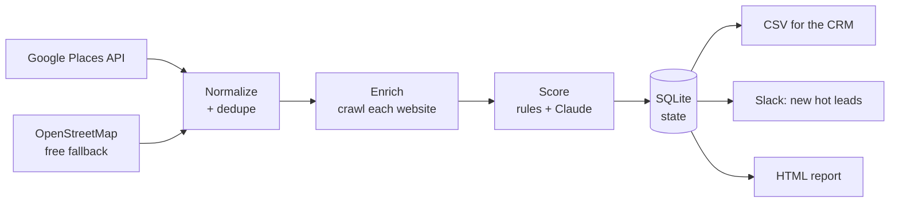

# leadpipe: find, enrich and AI-score B2B leads

[](https://github.com/liam22222/lead-data-pipeline/actions/workflows/tests.yml)

**One command turns "dental clinics in Austin" into a ranked, contactable lead list,** with the reason each lead is worth calling and an opening line for the pitch.

```bash
leadpipe run --city "Austin, Texas"
```

```
<found> leads · <n> with website · <n> with email · <n> without online booking · <n> hot · <n> new
CSV:    output/dental-clinics-austin-texas.csv
Report: output/dental-clinics-austin-texas.html
```

The demo buyer is a **dental marketing agency** that sells online booking and patient-reactivation campaigns. Its best leads are independent clinics with a website but **no online booking yet**. Swap one config file and the same pipeline finds law firms, gyms, real estate agencies or any business type in OpenStreetMap.

## How it works



| Stage | What it does |
|---|---|
| **Source** | **Google Places API (New)** Text Search with several phrasings ("dentist", "orthodontist", …), returning website, phone, rating and review count. About 12 calls per city, inside the 1,000 free calls a month. Without a key it uses **OpenStreetMap** (Nominatim + Overpass): free, but many businesses are missing a website or phone there. |
| **Normalize + dedupe** | Cleans URLs, phones (E.164) and emails, and merges duplicates found by different searches, matched by domain, then phone, then name + location. A website shared by 3+ locations marks a **chain**. |
| **Enrich** | Visits each website plus one contact/booking page and extracts emails, phones, social profiles, contact forms, **online-booking widgets** (NexHealth, Zocdoc, LocalMed, Calendly…), premium services (implants, Invisalign…), the site platform, and whether the name looks like a chain. Google rating and review count come along from the source (few reviews = an easy pitch for review generation). |
| **Score** | A transparent rule-based score (0–10) with reasons, plus an optional **Claude** score against the plain-English ideal customer profile, with a one-line reason and a suggested opening pitch. AI results are cached, so re-runs cost nothing. |
| **Store** | SQLite keeps state between runs: leads are flagged **new**, websites are only re-crawled after `--refresh-days`, and every run is logged. |
| **Deliver** | A CSV ready for any CRM import, a Slack alert with only the **new hot** leads, and a self-contained HTML report (KPIs, score distribution, searchable and sortable table). |

## Built for production, not just a demo

- **Polite and resilient crawling:** identifies itself with a contact email, rate-limits per host, retries with backoff (honours `Retry-After`), and one dead website never stops the run.
- **AI with a safety net:** if the API key is missing or a call fails, the lead keeps its rule-based score, so the pipeline never blocks on the model.
- **Incremental:** run it daily from cron; only new or stale leads cost crawling time and API calls.
- **Config, not code:** a niche is one TOML file holding the OSM tags, chain keywords, buying signals, scoring weights and the ideal customer profile.
- **Tested offline:** 26 tests with recorded fixtures cover Google paging, chain detection, geocoding fallback, parsing, dedup, extraction, scoring, AI caching and failure, incremental runs and Slack filtering. CI runs on Python 3.10 and 3.12.

## Quick start

```bash
git clone https://github.com/liam22222/lead-data-pipeline && cd lead-data-pipeline
python -m venv .venv && source .venv/bin/activate
pip install -e ".[dev]"
cp .env.example .env        # GOOGLE_MAPS_API_KEY (recommended), ANTHROPIC_API_KEY, SLACK_WEBHOOK_URL

leadpipe run --city "Austin, Texas" --limit 20     # quick test
leadpipe run --city "Austin, Texas"                # full run
pytest -q
```

| Option | Default | |
|---|---|---|
| `--city` | required | Any place name Nominatim understands |
| `--niche` | `leadpipe/niches/dentists.toml` | Niche config file |
| `--source` | `auto` | `google`, `osm`, or `auto` (Google if a key is set) |
| `--limit N` | all | Only process the first N leads |
| `--refresh-days` | 14 | Re-crawl a website only after this many days |
| `--no-ai` / `--no-slack` | off | Rule score only / don't post to Slack |
| `--osm-file` | | Replay a saved Overpass response (offline) |

## Add a niche

Copy `leadpipe/niches/dentists.toml`, change the Google search phrases, the OSM tags (see the [OSM wiki](https://wiki.openstreetmap.org/wiki/Map_features)), the signals and the ideal customer profile, and run with `--niche path/to/file.toml`.

## Project layout

```
leadpipe/
  sources/google.py  Google Places API (New) text search
  sources/osm.py   Nominatim / Photon + Overpass
  normalize.py     URL / phone / email cleanup, dedup + merge
  enrich.py        website crawl and signal extraction
  scoring.py       rule score + Claude scorer with disk cache
  store.py         SQLite state and run log
  outputs.py       CSV, Slack, HTML report
  pipeline.py      the run, stage by stage
  cli.py           command line
  niches/          niche configs
tests/             offline tests + fixtures
```

## Data and responsible use

Business data comes from Google Places (subject to the [Google Maps Platform terms](https://cloud.google.com/maps-platform/terms)) or [OpenStreetMap](https://www.openstreetmap.org/copyright) (© OpenStreetMap contributors, ODbL). Follow the [Nominatim](https://operations.osmfoundation.org/policies/nominatim/) and Overpass usage policies, set a real `CONTACT_EMAIL`, and respect anti-spam laws (CAN-SPAM, GDPR) when contacting leads. The crawler only reads public business pages.

---

Built by Liam A., data & automation engineer. Need a pipeline like this for your business? [Find me on Upwork](https://www.upwork.com/freelancers/~01884dc7f75a62b410).
